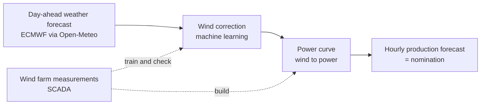

# Day-ahead wind power forecasting for wind farm nomination

Capstone project: a more accurate day-ahead production forecast for a wind farm, so that its market nomination is closer to real production and the imbalance cost is lower.

## In short
Wind farms have to promise today how much electricity they will produce tomorrow. This project uses two years of real data from a Scottish wind farm and archived weather forecasts to learn where the forecast goes wrong, and to correct it, so that the promise matches reality more closely.

## Why this matters
The power grid must be balanced at every moment: the electricity produced has to match the electricity used. To plan this, every power plant tells the market one day ahead how much it will produce in each hour. This plan is called the **nomination**.

A gas plant can simply decide how much to produce. A wind farm cannot: its production depends on tomorrow's wind, so its nomination is only as good as the weather forecast.

When real production differs from the nomination, the grid operator has to cover the difference with other power plants, at short notice and at a higher price. The wind farm pays for this difference, called **imbalance**. Better forecasts therefore mean:
- lower costs for the wind farm,
- less expensive backup power for the grid,
- easier integration of more wind energy into the power system.

## Problem
Day-ahead wind forecasts come from numerical weather prediction (NWP) models, which are computer simulations of the atmosphere. They work on grid cells several kilometres wide, so they cannot see local details such as hills, forests or the wind farm itself. As a result, the forecast wind at the turbines is often too strong, too weak, or a few hours early or late.

These errors grow when wind is turned into power. In the main operating range, a turbine's power rises roughly with the cube of the wind speed. If the wind is 9 m/s instead of the forecast 8 m/s (about 12% more), the turbine produces about 40% more power. Small wind errors therefore become large production errors, and every MWh of difference costs money.

## Goal
Turn the day-ahead weather forecast into a more accurate hourly power forecast for the whole wind farm, and measure how much of the improvement comes from a better wind forecast.

## Approach

1. **Learn from history:** compare two years of archived forecasts with what the turbines actually measured and produced.
2. **Correct the wind:** train a model that learns the systematic forecast errors, for example by wind direction, time of day and season.
3. **Convert wind to power:** use the wind farm's own power curve, built from its measurements.
4. **Measure the benefit:** compare with the raw forecast in forecast error, MWh of imbalance and imbalance cost.

## Example of the value
A 48 MW wind farm produces about 127,000 MWh per year. A typical day-ahead forecast error causes roughly 50,000 MWh of imbalance per year. At an assumed average cost of €15/MWh, that is about €760,000 per year. Reducing the forecast error by 10% would save about €76,000 per year.
*(Illustrative numbers. The project computes the real values from hourly market prices.)*

## Key terms
| Term | Meaning |
|---|---|
| Nomination | The hourly production plan a power plant submits to the market one day ahead |
| Imbalance | The difference between the nomination and real production, paid by the producer |
| Day-ahead | A forecast for tomorrow, made today before the market deadline |
| NWP | Numerical weather prediction: a computer model that simulates the atmosphere |
| SCADA | The wind farm's monitoring system; it records power, wind and turbine status every 10 minutes |
| Power curve | How much power a turbine produces at each wind speed |

## Status
- [x] SCADA preprocessing (notebook 01)
- [x] Download of day-ahead NWP forecasts (notebook 02)
- [ ] Hourly aggregation, filters, empirical power curve
- [ ] Wind correction and power forecast models
- [ ] Evaluation: forecast error, imbalance energy and cost

## Data

**Datatype**: Time Series & Numeric  
**DS Problem**: Regression    
  
| Source | Content | Period | Output |
|---|---|---|---|
| [Hill of Towie open dataset v2.1.0](https://doi.org/10.5281/zenodo.22662930) (CC BY 4.0) | 10-min SCADA, 21 Siemens SWT-2.3-VS-82 turbines (48.3 MW), Scotland | Apr 2024 – Apr 2026 | `data/processed/*.parquet` (1st notebook) |
| [Open-Meteo Single Runs API](https://open-meteo.com/en/docs/single-runs-api) (CC BY 4.0) | ECMWF IFS HRES 9 km, runs 00/12 UTC, lead 0–48 h | Apr 2024 – Apr 2026 | `data/nwp/*.csv` (2nd notebook) |
  
Raw SCADA data is not stored in this repository. Download `2024.zip`, `2025.zip`, `2026.zip` and `Hill_of_Towie_turbine_metadata.csv` from [Zenodo](https://zenodo.org/records/22662930) and unzip each year into `data/2024/`, `data/2025/`, `data/2026/`.

## How to run
```bash
pip install -r requirements.txt
```
1. `notebooks/01_scada_preprocessing.ipynb` – selects ~30 SCADA columns and saves turbine- and farm-level Parquet files.
2. `notebooks/02_nwp_open_meteo.ipynb` – downloads every forecast run and saves one CSV file.

## Repository structure
```
├── notebooks/
├── data/     
│   ├── SCADA/
│   └── nwp/  
├── requirements.txt
└── README.md
```

## Results
<!-- TODO: add after model evaluation -->

## Citation
- Clerc, A., & Lingkan, E. (2026). *Hill of Towie wind farm open dataset* (v2.1.0). Zenodo. https://doi.org/10.5281/zenodo.22662930
- Weather data by [Open-Meteo.com](https://open-meteo.com/). Zippenfenig, P. (2023). *Open-Meteo.com Weather API*. Zenodo. https://doi.org/10.5281/ZENODO.7970649

## Author
Aleksandar Zecevic – [@A3eko](https://github.com/A3eko)
